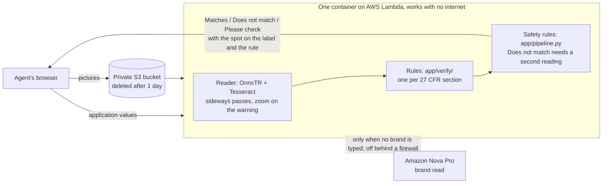

# Label Check: alcohol label verification prototype

A TTB agent uploads a label's pictures and the application's values. In about 5 seconds the app answers each item with **Matches**, **Does not match** or **Please check**, shows the spot on the label, and cites the 27 CFR rule. It also checks batches of hundreds of applications. **The agent decides; the app never approves a label.**

**Live:** https://3jirlgdkpcw55t54gz32ggdnbq0yfrjp.lambda-url.us-east-1.on.aws/ (the first visit after a quiet period takes about 6 seconds)
- **No files needed:** press **Try a label that matches** or **Try a label with a problem**.
- **Batch:** on **Check many labels**, download the sample batch (22 applications, 2 broken on purpose) and add it.
- **Pictures only:** add pictures and leave the boxes blank. The app fills in what the label says and reports each required statement as **On the label** or **Please check**.

## Results

Held-out final test: 162 items, never tuned on, locked by checksum, run once on the live version ([log](docs/evidence/final_test.log)).

| Set | Wrong answers | Mistakes caught | Items confirmed automatically |
|---|---|---|---|
| 28 real TTB-approved labels | **0** | – | 77% |
| 46 of them with one planted mistake | **0** | **46 / 46** | 75% |
| 48 generated labels, 32 with planted mistakes | **0** | **32 / 32** | 94% |
| 40 phone-style photos (22 approved, 18 with a planted mistake) | **0** | **18 / 18** | 16–19% |

- **Practice sets:** 227 real approved labels, 178 with planted mistakes, 96 generated. **0 wrong answers; 242 of 242 mistakes caught;** 68–93% of items confirmed automatically.
- **Speed:** 0.7–2.6 s typical, 4.5 s slowest per label. On the live site, 2.5–5.1 s with nothing typed.
- Items the app can't settle say Please check and go to the agent. Photos are the weakest case: no wrong answers, but most items are left to the agent.
- Full numbers, the changes made since the final test, and how the answer key was built: [`docs/RESULTS.md`](docs/RESULTS.md).

## How it works



- **Verify, don't guess.** The application says what the label should contain, so the app searches the label for those values.
- **Reads locally, with no internet.** OnnxTR reads the text, with a word reader I fine-tuned on label fonts ([training and results](docs/APPROACH.md#reader-training)), and Tesseract gives an independent second reading. The app works behind an agency firewall.
- **One optional exception.** When no brand is typed, Amazon Nova Pro reads it from the pictures, because brands are usually logos. It is shown for the agent to confirm and is never used for "Matches". If it can't be reached, the brand says Please check.
- **Rules are plain code** (`app/verify/`), one per regulation, listed with citations in [`docs/RULES.md`](docs/RULES.md). No AI model decides a verdict.
- **Built to avoid wrong answers.** A difference must be confirmed by a second reading. A missing item is Please check, never Does not match. Where TTB approves labels that bend a rule, the app says Please check ([`docs/FINDINGS.md`](docs/FINDINGS.md)).

## What it checks

| Item | Rule (27 CFR) |
|---|---|
| Brand, class/type, name and address, country of origin | Parts 4, 5, 7: text match, ignoring case and punctuation |
| Alcohol content, proof | §§ 4.36, 5.65, 7.65: compared as numbers in any format; proof = 2 × alcohol |
| Net contents | Any unit; standard sizes; beer must show U.S. units (§ 7.70) |
| Health warning | Part 16: word for word, "GOVERNMENT WARNING" in capitals, bold and type size (advisory) |
| Class rules | Minimum alcohol by class (§§ 5.142–5.151), bottled in bond (§ 5.88), table wine (§ 4.21), low/non-alcoholic beer wording (§ 7.65) |
| Pictures only | Each required statement found on the label (§§ 4.32, 5.63, 7.63) |

What it does not check, and why: [`docs/RULES.md`](docs/RULES.md) §6b.

## How I tested it

| Layer | What it proves |
|---|---|
| 1,178 automated tests (`tests/`) | Each rule, edge cases from real labels, the web pages, batch pairing, and a run with the network switched off |
| Practice sets (`tools/evaluate.py`) | Scored against an answer key on real, altered and generated labels |
| Safety gate (`tools/gate.py`) | Blocks any deploy without 0 wrong answers, every mistake caught, and 95% of labels within 5 s |
| Offline container check | The built container, with networking switched off, must get the samples right |
| Final test | A held-out set, run once |

## Tools

| Part | Tools |
|---|---|
| Reading | OnnxTR on ONNX Runtime (plus my fine-tuned word reader), Tesseract, OpenCV |
| Rules | Python 3.12, RapidFuzz |
| Web | FastAPI, Jinja, U.S. Web Design System |
| Hosting | Docker, AWS Lambda (arm64), S3 for uploads; $0 idle, about $0.0005 per label |
| Optional brand read | Amazon Nova Pro on Bedrock |
| Building | AI coding tools, with every rule, number and claim checked by me |

## Run it

```bash
python3.12 -m venv .venv
.venv/bin/pip install -r requirements.txt onnx
.venv/bin/python tools/make_dynamic_det.py         # one-time: fetch the reading models
.venv/bin/pytest                                   # 1,178 tests
.venv/bin/uvicorn app.web.main:app --port 8000     # http://localhost:8000
```

Docker (no network needed once built): `docker build -t label-check . && docker run --rm -p 8080:8080 label-check`

## Deployment

`tools/deploy.sh` stops at the first failure:
1. Tests.
2. Safety gate.
3. Build the container, then check it with networking off.
4. Switch the live site and check it again.

- AWS Lambda behind a function URL; at most 12 copies run at once, with a budget alert.
- Uploads go to a private S3 bucket and are deleted after one day. Results are not stored.
- The bucket exists only on AWS, because Lambda requests are limited to 6 MB. Anywhere else, the pictures go straight to the container.
- The same container runs on any Docker host, Azure Container Apps included.

## Limitations

- Script logos and curved text are often unreadable; those items say Please check.
- A batch runs in the browser tab and stops if the tab is closed.
- There is no COLA integration (out of scope); the agent types the values or supplies a spreadsheet.
- Type size is checked only when the label height is given; bold and type size are advisory.
- No login (public prototype). "I disagree" notes stay with the page; nothing is stored.

## Production at TTB

I used AWS because it was the fastest, cheapest way to prove the idea; the same container moves to the agency's approved cloud (Azure Government or AWS GovCloud) or its own servers. At 150,000 applications a year, the computing costs about $75. What I would change:

1. **Check on arrival.** Check each application when it is submitted and store the result, so the agent opens a finished check and peak-season dumps wait in a queue.
2. **Server-side batches.** Run batches as jobs on a queue that survive a closed tab, with capacity kept separate from single checks.
3. **Reuse readings.** Fingerprint each picture so shared back labels and resubmissions are read once. Show only the words that changed between versions.
4. **Read the brand inside the boundary,** with an AI model in the approved cloud or on agency servers, backed by TTB's database of approved brands.
5. **Quiet trial.** Run alongside agents for a few weeks and measure wrong answers against their decisions, as [OMB M-25-21](https://www.whitehouse.gov/wp-content/uploads/2025/02/M-25-21-Accelerating-Federal-Use-of-AI-through-Innovation-Governance-and-Public-Trust.pdf) requires for high-impact AI.
6. **Monitoring.** Track each answer's rate weekly without storing labels, to catch drift early ([NIST AI RMF](https://www.nist.gov/itl/ai-risk-management-framework)).
7. **Learn from agents.** "I disagree" notes become rule fixes or training examples. A person approves each one, and it ships only through the safety gate.
8. **Better data.** Test against TTB's approved *and rejected* history and a library of past decisions shown to agents as reference.
9. **Applicant pre-check** in COLAs Online, so common mistakes are fixed before an agent sees them.
10. **Enterprise basics:**
    - PIV/CAC sign-in;
    - an audit log;
    - Section 508 review;
    - an authority to operate (ATO);
    - load testing;
    - the rule version recorded with every result.

The reasoning behind each step: [`docs/PRODUCTION.md`](docs/PRODUCTION.md).

## Repository map

| Path | What |
|---|---|
| `app/verify/` | The rules, as small pure functions |
| `app/ocr/` | Label reading: main pass, rotated passes, zoom re-read of the warning |
| `app/pipeline.py` | Reading plus rules for one application, with the safety rules |
| `app/web/` | FastAPI pages: single label and batch |
| `docs/` | Approach and assumptions, rules with citations, findings, results, production plan |
| `data/` | Real approved labels (TTB Public COLA Registry), generated labels, answer key, frozen practice and final splits |
| `tools/` | Data collection, label generator, evaluation, safety gate, deploy, reader training |
