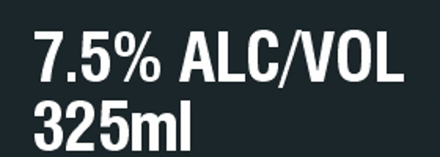

# What Real Labels Taught Us

The first version of the rules followed the regulations to the letter. Running them against real labels that TTB has **approved** showed three places where that was stricter than TTB itself. A tool that rejects approved labels would lose agents' trust immediately, so each rule was changed to **Please check**: the tool flags it and a person decides.

Every case below can be verified independently: the TTB ID opens the public registry record, which shows the approved label images.

Registry record link pattern: `https://www.ttbonline.gov/colasonline/viewColaDetails.do?action=publicFormDisplay&ttbid=<TTB ID>`

---

## 1. Beer labeled only in metric units

**The regulation.** 27 CFR 7.70: malt beverage net contents must be stated in U.S. units (e.g. "12 FL. OZ."); metric may only be added.

**The approved label.** Guinness Foreign Extra Stout, imported from Nigeria. TTB ID **23328001000154**, approved 01/08/2024. Both label images state the contents only as **"325ml"** / **"325 ML"**. No fluid ounces appear anywhere on the label.

**Why TTB can approve it.** Net contents may be "blown, embossed, or molded into the container" instead of printed on the label (27 CFR 7.63(a)(5)). The label alone can't prove a violation.

**Rule change.** Metric-only net contents on a malt beverage label → **Please check** ("confirm the U.S. statement appears on the container"), not Does not match. The same reasoning makes "net contents not found on the label" a Please check for every beverage type.

---

## 2. Warning statement missing a period

**The regulation.** 27 CFR 16.21 gives the exact statement, including a period after "birth defects" and at the end ("…may cause health problems.").

**The approved labels:**

| Label | TTB ID | Approved | What's printed |
|---|---|---|---|
| [ yellow tail ] Moscato | **24061001000635** | 03/05/2024 | "…OF BIRTH DEFECTS (2) CONSUMPTION…": no period after DEFECTS |
| [ yellow tail ] Cabernet Sauvignon | **24061001000628** | 03/07/2024 | Same: no period after DEFECTS |
| Robert Mondavi Winery sparkling wine | **24053001000106** | 02/26/2024 | "…MAY CAUSE HEALTH PROBLEMS": no final period |

**Rule change.** Every **word** must still match exactly; a changed, missing or added word is Does not match. A **punctuation-only** difference is **Please check**. This keeps the strictness where the rule's purpose is (the wording of the health message, and the all-caps heading Jenny described) without rejecting labels TTB accepts. OCR also misreads small punctuation more often than words, which is another reason not to reject on it.

---

## 3. Non-alcoholic beer has no warning

**The regulation.** The Health Warning is required on "alcoholic beverages," which 27 CFR 16.10 defines as containing "not less than one-half of one percent (.5%) of alcohol by volume."

**The approved label.** Heineken 0.0, TTB ID **24165001000500**, approved 06/20/2024, class "Cereal Beverages – Near Beer (Non Alcoholic)". The label states **"ALC. 0.0% BY VOL."** and carries no Government Warning, correctly.

**Rule change.** When the application declares less than 0.5% alcohol, the warning and alcohol-content checks are skipped (shown as "not applicable", with the reason).

---

## How this is enforced going forward

`tests/test_datasets.py::test_real_approved_label_never_fails` runs the rules on every real approved label in the development set and fails if any field gets "Does not match". It caught cases 1 and 3 when the rules were first run. Case 2 was spotted earlier, while building the answer key, so the punctuation rule was written lenient from the start; the test now guards it. Any future case like these will fail the test until it's resolved.
